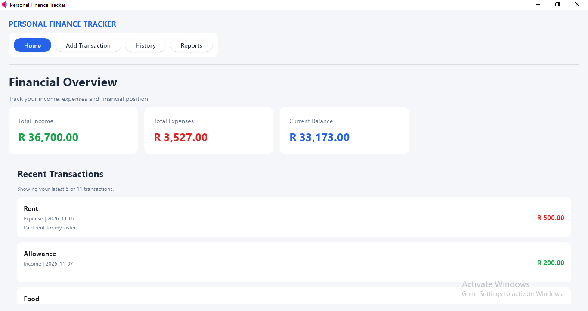
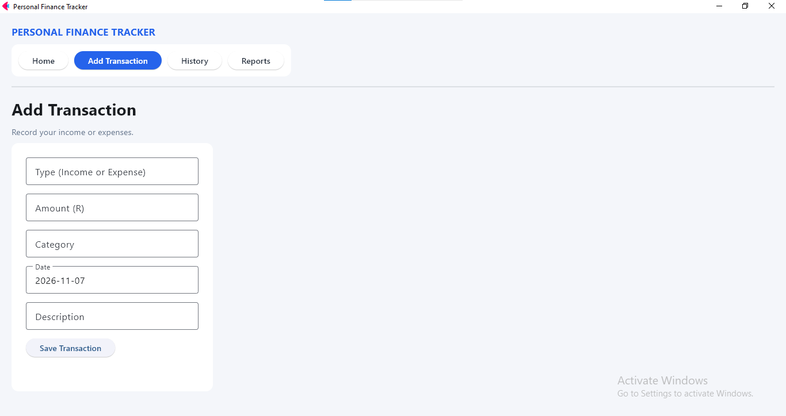
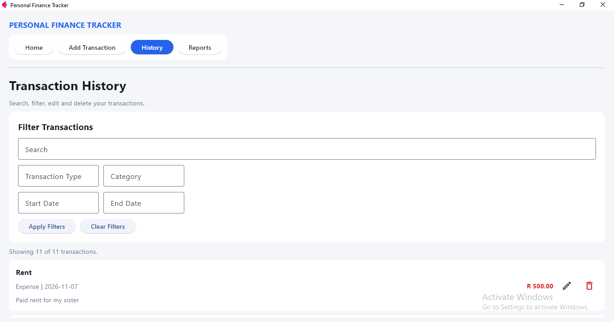
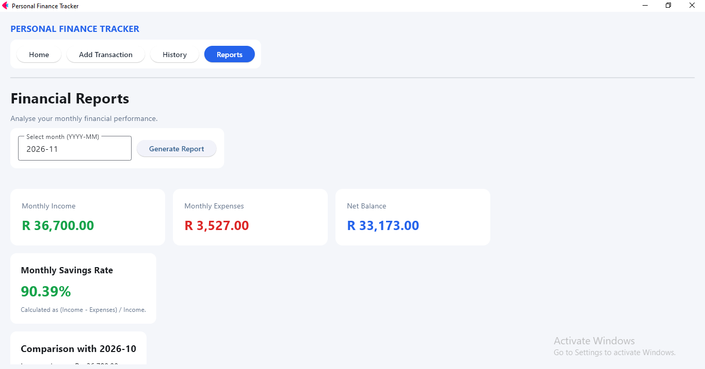

# Personal Finance Tracker

## Project Overview

Personal Finance Tracker is a desktop application developed using Python and Flet. It helps users manage their personal finances by recording income and expenses, tracking transactions, monitoring their financial position and analysing spending patterns.

The application provides an interactive dashboard, transaction management, financial reports and local JSON-based data storage to preserve transaction records between sessions.

## Features

- **Dashboard:** Displays total income, total expenses, current balance and the five most recent transactions.
- **Add Transactions:** Allows users to record income and expenses with input validation.
- **Edit Transactions:** Allows users to update existing transaction records.
- **Delete Transactions:** Allows users to remove unwanted transactions.
- **Transaction History:** Displays recorded transactions with search and filtering by transaction type, category and date.
- **Financial Reports:** Provides monthly income, expenses, net balance and savings rate.
- **Monthly Comparisons:** Compares financial performance with the previous month.
- **Data Visualisation:** Includes charts for monthly income versus expenses and expense distribution by category.
- **Interactive Navigation:** Provides navigation between the four main sections, with visual highlighting of the currently active section.
- **Persistent Storage:** Saves transaction records locally in JSON format.

## Technologies Used

- Python
- Flet
- Matplotlib
- JSON
- Object-Oriented Programming
- File Handling

## Project Structure

```text
personal_finance_tracker/
│
├── assets/
│     └── charts/
│       └── generated chart images
│   ├── add_transaction.png
│   ├── dashboard.png
│   ├── reports.png
│   └── transaction_history.png
│  
├── data/
│   └── transactions.json
│
├── main.py
├── README.md
├── requirements.txt
└── transaction.py
```

## Installation and Setup

1. Clone or download this repository.
2. Open the project folder in Visual Studio Code.
3. Install the required dependencies:

```bash
pip install -r requirements.txt
```

4. Run the application:

```bash
python main.py
```

## Data Storage

The application stores financial transactions locally in `data/transactions.json`.

Each transaction contains:

- Transaction type (Income or Expense)
- Amount
- Category
- Date
- Description

Transaction records are saved in JSON format and loaded when the application starts, allowing data to persist between sessions.

## Application Screenshots

### Dashboard



### Add Transaction



### Transaction History



### Financial Reports



## Application Purpose

This project demonstrates practical software development skills using Python, including object-oriented programming, file handling, JSON data persistence, graphical user interface development, data visualisation, input validation and software testing.
